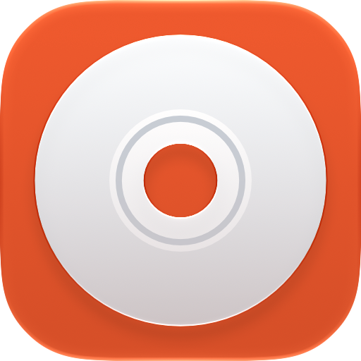
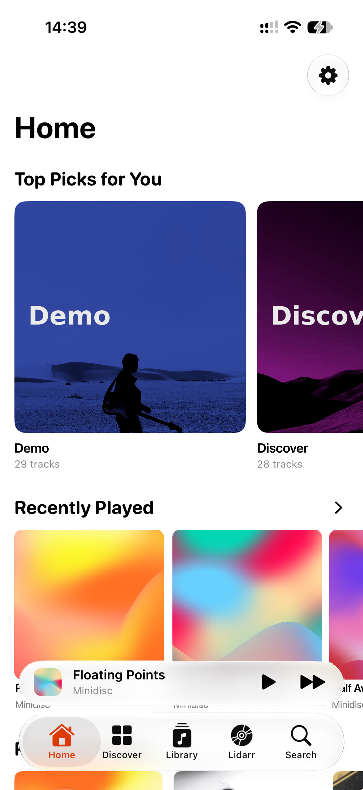
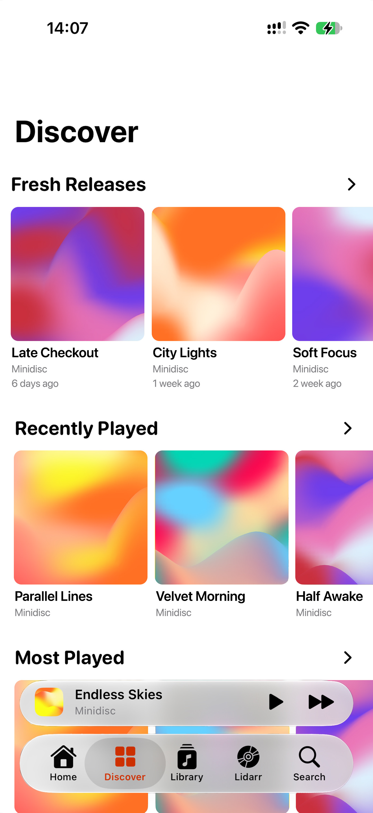
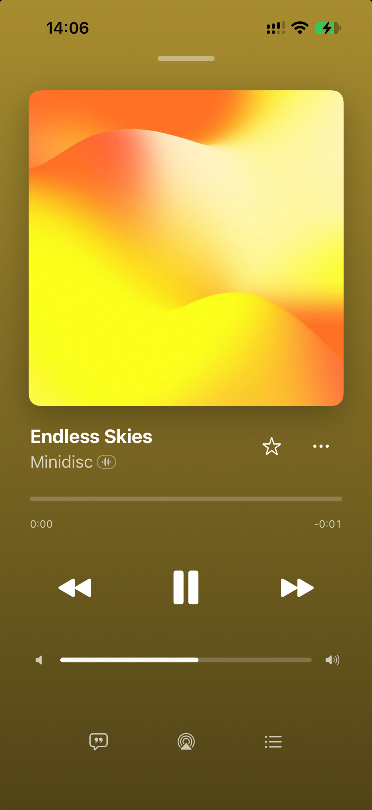
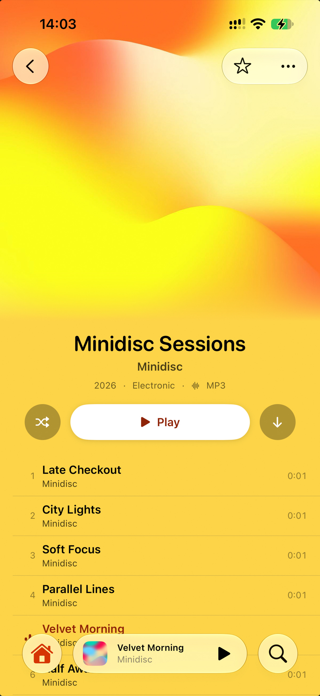
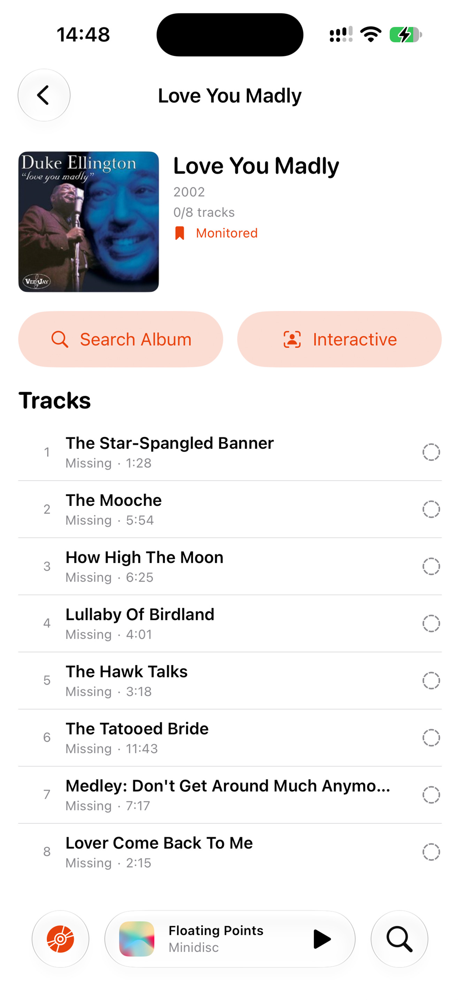

<p align="center">
  
</p>

<h1 align="center">Minidisc</h1>

<p align="center">
  Minidisc is an opinionated music player for iOS that brings together music from your own server and local files, with an experience close to Apple Music.
</p>

<p align="center">
  <a href="LICENSE"></a>
  <a href="#requirements"></a>
  <a href="https://swift.org"></a>
</p>

## Screenshots

|                        Home                        |                        Discover                        |                        Player                        |                        Album                        |                           Lidarr                           |
| :------------------------------------------------: | :----------------------------------------------------: | :--------------------------------------------------: | :-------------------------------------------------: | :--------------------------------------------------------: |
|  |  |  |  |  |

## What is Minidisc?

Minidisc is an opinionated music player for iOS, written in Swift and SwiftUI. Play local files, stream from your own server, or bring both together in one library. It uses the Subsonic and OpenSubsonic API, so it works with [Navidrome](https://www.navidrome.org) and with other servers that follow these standards.

Minidisc does not use accounts or subscriptions, and it does not track you, so your music stays between your device and your server. It gives you the same smooth experience as Apple Music, but it plays the music that you own.

## An opinionated fork

Minidisc is a fork of [Cassette](https://github.com/CassetteLab/cassette), which Mathieu Dubart wrote as a good client for iOS and macOS. Minidisc takes a different, narrower path, and it follows four rules:

- **iOS only.** Minidisc does not support macOS, because each screen is made for the phone.
- **Opinionated.** Minidisc has few settings and good defaults, because it makes the decisions for you and keeps the interface simple.
- **Smooth first.** Minidisc adds a function only when the function feels as good as Apple Music.
- **Familiar.** The tab bar, the mini-player, the player screen, and the Home shelves use the usual iOS patterns, so you do not have to learn them.

If you want the largest set of functions on Mac and iPhone, use Cassette. If you want the simplest iOS player for your own library, use Minidisc.

## Features

**A player that is close to Apple Music**

- Native iOS 26 design with Liquid Glass.
- A full-screen player with a large cover.
- A mini-player that stays in the tab bar, and you tap it to open the full player.
- A Home screen with your top picks, your recent music, and one shelf for each genre.
- Background playback with lock screen and Control Center controls.
- AirPlay support.
- CarPlay support for browsing your library and controlling playback from your car.

**Your library**

- Browse your playlists, artists, albums, downloads, and favorites.
- Local music folders, with songs and albums alongside your server music in Home, Discover, Library, and Search. Start with local files and connect a server later.
- Search all of your library.
- Offline mode, so you can download albums, playlists, or single tracks.
- Manage your favorites offline and sync them when you reconnect.
- Lyrics, shuffle, repeat, and a full queue.
- The app keeps your session and continues from the last position.

**More functions**

- **Wrapped** gives you a summary of your year of listening.
- **ListenBrainz** scrobbles your plays and gets recommendations for you.
- **AudioMuse-AI** builds weekly mood playlists from the sound of your music.
- **Lidarr** manages your music collection from the app: add artists, monitor and search for missing albums, pick releases with an interactive search, and follow the download queue with manual import.
- **Animated album artwork** in the player and on the Lock Screen when your server provides a supported animated cover.
- **Siri and Shortcuts** let you start music from your library and control playback.

**Privacy**

- Minidisc does not track you. Library and playback traffic goes directly to your configured server.
- If you use LRCLIB for lyrics, directly or as a fallback, it receives song details but never your server credentials.
- Minidisc keeps your credentials only in the iOS Keychain.
- Minidisc can send custom HTTP headers for a server behind a reverse proxy, for example Cloudflare Access or Authelia.

## Installation

### iOS: sideload the app

1. Download the `.ipa` file from the [Releases](../../releases) page.
2. Install the file with AltStore, Sideloadly, or a different sideload tool. The tool signs the app with your Apple ID during the installation.

### Build from the source

You need these items:

- macOS 15 or later, with Xcode 26 or later.
- Local music files or a Subsonic, OpenSubsonic, or Navidrome server.
- An Apple Developer account for signing builds on a physical device.

Do these steps:

1. Clone the repository and open the project.
    ```bash
    git clone https://github.com/Loriage/Minidisc.git
    cd Minidisc
    open Minidisc.xcodeproj
    ```
    Swift Package Manager fetches SwiftSonic, the Minidisc AudioStreaming fork, and its codec dependencies automatically.
2. Select your team in **Signing & Capabilities** and configure Siri and CarPlay for your App ID. CarPlay signing requires the corresponding [entitlement from Apple](https://developer.apple.com/carplay/).
3. Select an iOS 26.1 or later device or simulator.
4. Build and run the app when you press Command-R.
5. At the first start, choose local music folders or connect to a server. To connect, enter your server address, username, and password, then tap **Connect**. If your server is behind a reverse proxy that needs custom headers, open **Advanced** and add the headers.

## Requirements

- iOS 26.1 or later.
- Local music files or a Subsonic, OpenSubsonic, or Navidrome server. A server is optional when using local files.

## Server compatibility

Minidisc works with each server that has the Subsonic or OpenSubsonic API. Navidrome is the recommended server, and the team tests Minidisc primarily with Navidrome. If your server has the Subsonic API but a function does not work, [open an issue](https://github.com/Loriage/Minidisc/issues).

## Architecture

This information is for developers:

- **UI.** SwiftUI views with `@Observable @MainActor` view models, and the views have no business logic.
- **Services.** Swift actors, for example `PlayerService` and `LibraryService`, that do not import SwiftUI or UIKit.
- **Playback.** `AudioStreamingEngine` uses a custom [AudioStreaming fork](https://github.com/Loriage/AudioStreaming) for gapless playback, crossfades, ReplayGain, and Opus support. It connects to `MPNowPlayingInfoCenter` and `MPRemoteCommandCenter` for system playback controls.
- **Subsonic API.** [SwiftSonic](https://github.com/CassetteLab/swiftsonic) handles Subsonic and OpenSubsonic requests.
- **Integrations.** ListenBrainz, AudioMuse-AI, and Lidarr each have their own client and settings.
- **Persistence.** SwiftData for the app data, and Keychain for the credentials.
- **Concurrency.** Swift 6 strict concurrency.
- **Dependencies.** SwiftSonic and the AudioStreaming fork. AudioStreaming also brings in Ogg, Vorbis, and Opus codec packages.

## License

Minidisc uses the [MPL-2.0](LICENSE) license.

- You can use, study, change, and share the source.
- Changed files stay under MPL-2.0, but you can combine them with proprietary code in a larger work.

Dependencies: [SwiftSonic](https://github.com/CassetteLab/swiftsonic) and [AudioStreaming](https://github.com/Loriage/AudioStreaming) use the MIT license. The Ogg, Vorbis, and Opus codec dependencies use BSD-style licenses.

> Code before commit 21f9227 used the GPL-3.0-or-later license.

## Acknowledgments

- [Cassette](https://github.com/CassetteLab/cassette) by Mathieu Dubart, because Minidisc is a fork of Cassette.
- [AudioStreaming](https://github.com/dimitris-c/AudioStreaming) by Dimitris C., the audio streaming engine behind Minidisc. Minidisc uses a [custom fork](https://github.com/Loriage/AudioStreaming) with Opus support.
- The [Navidrome](https://www.navidrome.org) team, because Navidrome is an excellent self-hosted music server.
- The [OpenSubsonic](https://opensubsonic.netlify.app) community, because they modernized the Subsonic API.

